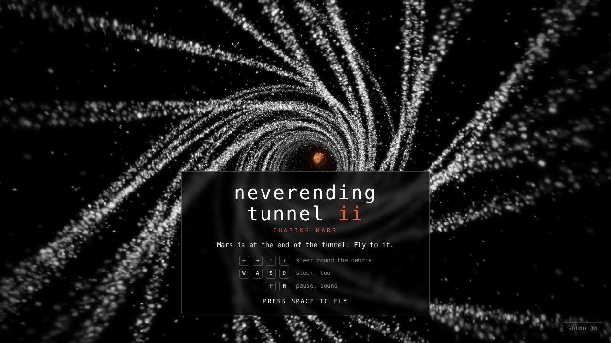
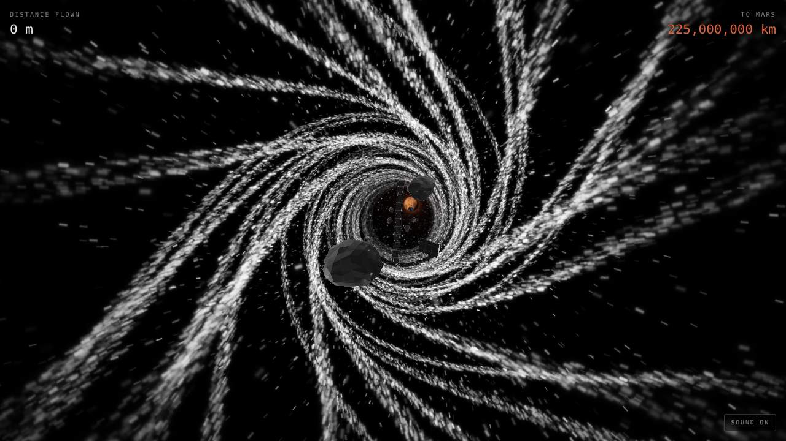
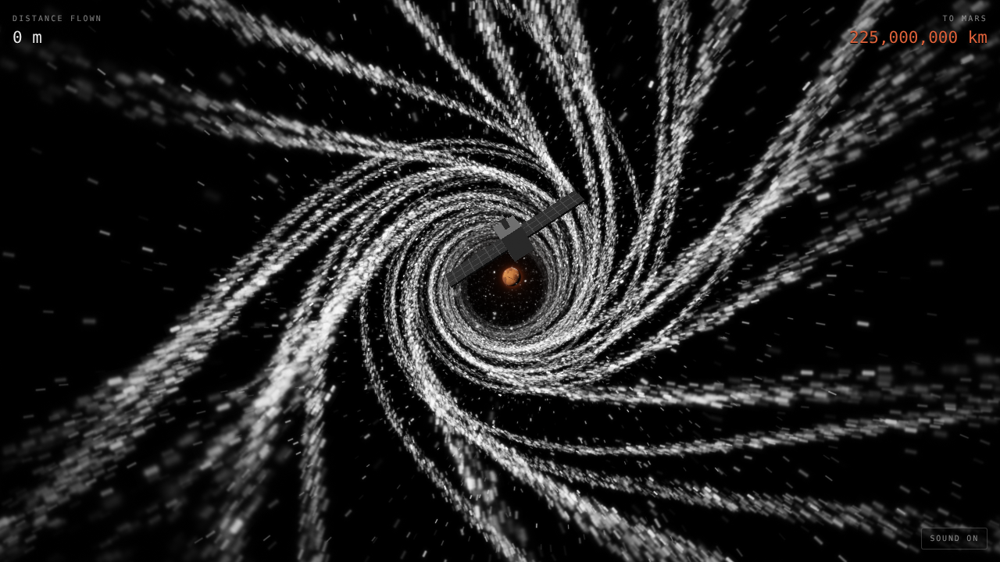
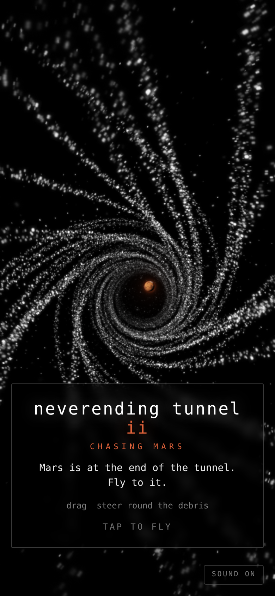

# Neverending Tunnel II: Chasing Mars

Fly down an endless vortex of light, round the space debris, towards Mars.
Mars is at the end of the tunnel. You never reach it.

The vortex is black and white glitter spiralling into a black hole, and Mars
sits in the hole: the only colour there is. It is drawn with WebGPU where the
browser has it and WebGL 2 where it doesn't, with the same shaders written
for each (WGSL in `src/shaders`, GLSL in `src/shaders/gl`).



| | |
|---|---|
|  |  |
| Rocks, a girder, shards and a belt | A dead satellite |
|  | |
| On a phone | |

## Run

```sh
npm install
npm run dev      # http://localhost:5173
npm run build    # static build in dist/
```

Needs WebGPU or WebGL 2 (any current browser). `?renderer=webgl` or
`?renderer=webgpu` pins one, and `?particles=60000` sets how many particles
the vortex has (it otherwise starts at 140,000, or 60,000 on phones, and
thins itself out if frames run slow).

## Controls

- ← → ↑ ↓ / W A S D: steer
- Drag: steer, on a phone
- Space / tap: fly, fly again
- P: pause, M: sound

## Debris

- Rocks, alone or in clusters
- Dead satellites, turning, with solar panels that sweep round
- Girders right across the tunnel
- Belts of rocks with one way through
- Shards of panel, tumbling

Passing close is a near miss: you'll hear it go by.

## Sound

All made as it plays, with Web Audio. The drone is a Shepard tone: it rises
for ever and never gets any higher. Under it there is a sub-bass hum, wind
that rushes harder the faster you fly, a thin hiss high up, and glitter: tiny
high pings, a few of the sparkles going past.

## Layout

- `src/shaders/particles.wgsl`: the vortex, every particle made up from its index
- `src/shaders/debris.wgsl`: rocks, satellites, girders and shards
- `src/shaders/mars.wgsl`: Mars, its canyon, ice caps and glow
- `src/shaders/post.wgsl`: tone mapping, vignette, flash and fade
- `src/shaders/gl/`: the same four for WebGL 2
- `src/gpu.js`, `src/gl.js`: the WebGPU and WebGL 2 renderers; `src/renderer.js` picks one
- `src/frame.js`: packs each frame's uniforms once for either renderer
- `src/game.js`: flying, steering, debris, collisions and near misses
- `src/meshes.js`: the rocks and the box everything else is made of
- `src/main.js`: the frame loop
- `src/input.js`, `src/hud.js`, `src/sound.js`: controls, HUD, audio
- `src/constants.js`, `src/math.js`: shared numbers and helpers
